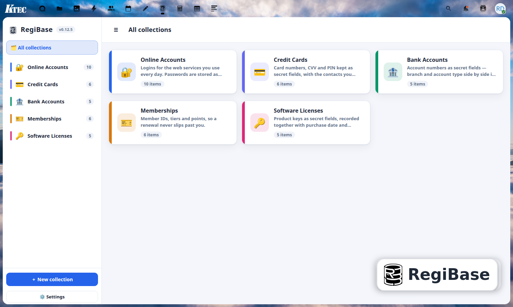
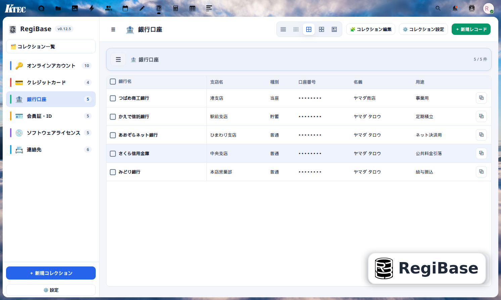
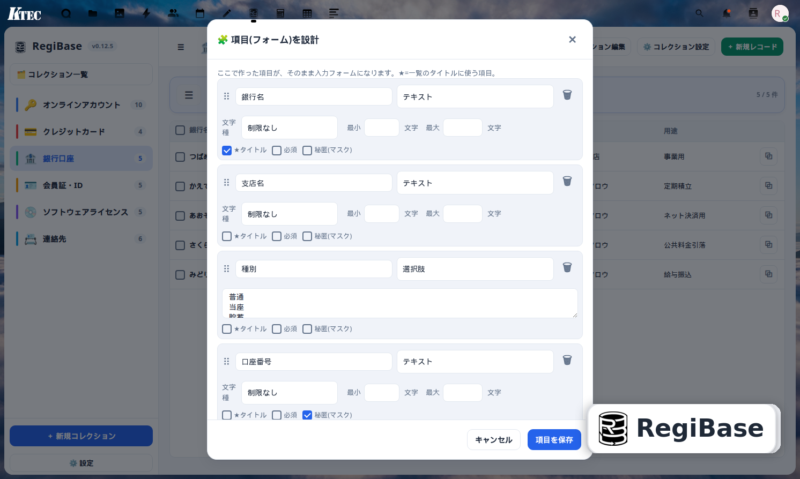
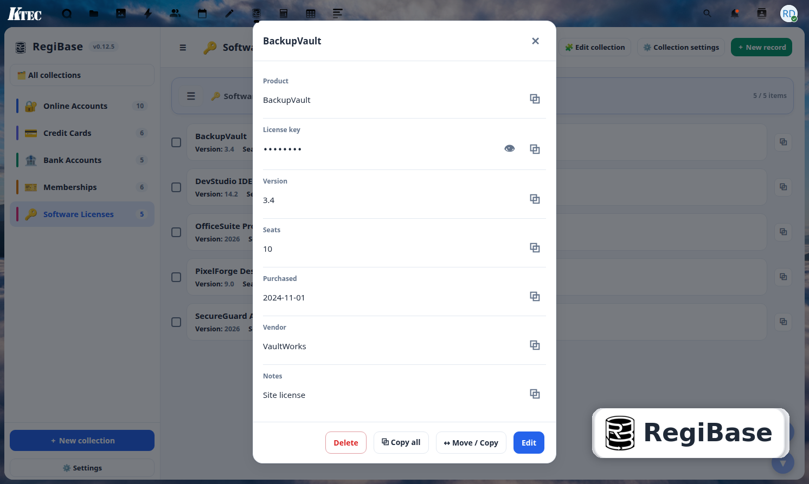
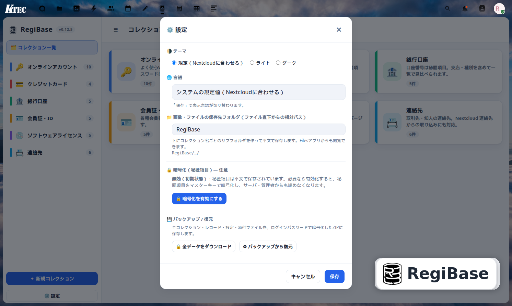
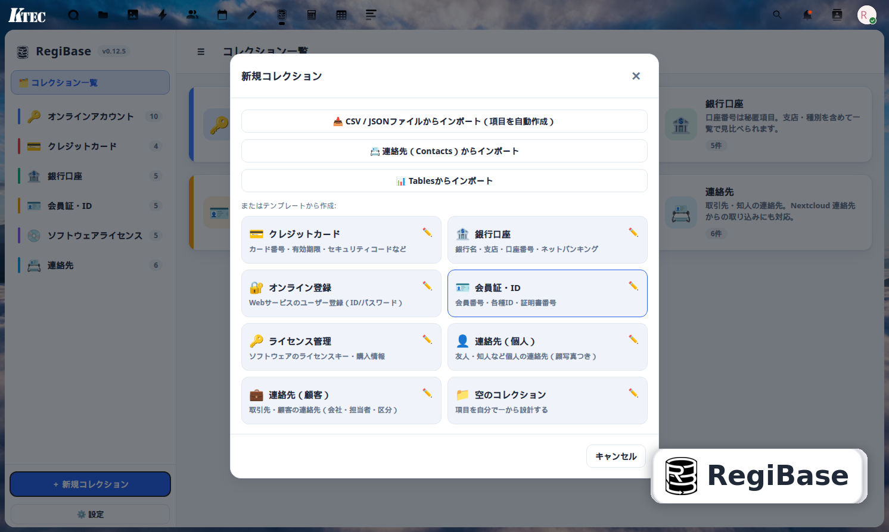
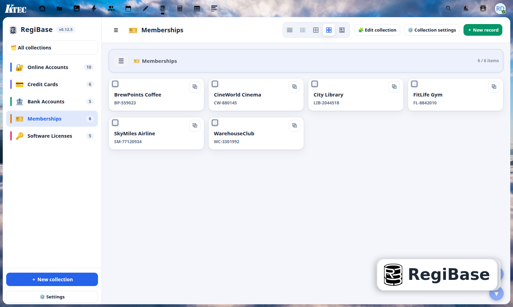
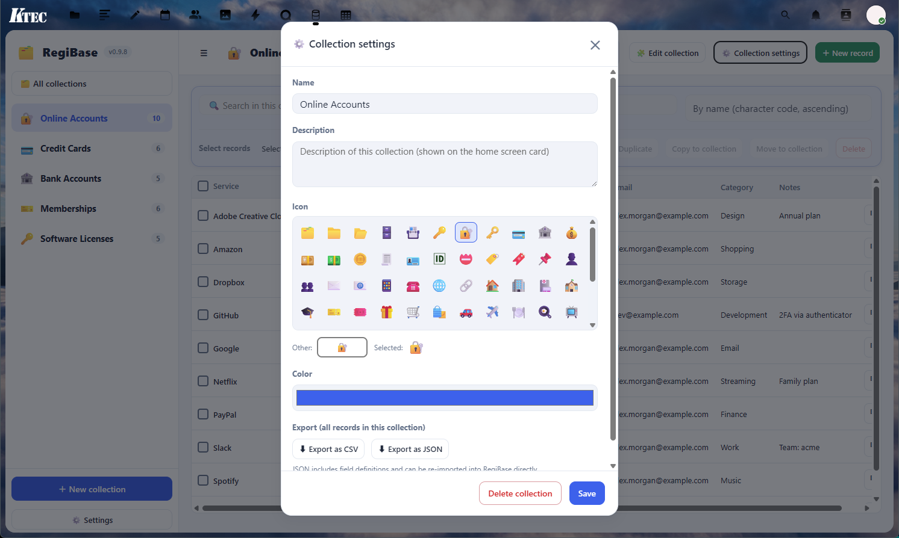

# RegiBase 🗄️

A small personal-database app for Nextcloud. It keeps everyday information in
collections whose fields you set up yourself.
Nextcloud 用の小さなパーソナルデータベースです。日々の情報を、項目を自由に設定できる
コレクションに整理して保管できます。

> A personal project, written for my own use and shared in case it is useful to someone.
> Self-hosted; your data stays in your own Nextcloud.
> 自分で使うために作った個人プロジェクトです。どなたかのお役に立てればと思い、公開しています。
> セルフホスト型なので、データはお使いの Nextcloud の中にだけ保存されます。

[English ↓](#english) · [日本語 ↓](#japanese)

---

<a id="english"></a>

## English

A Nextcloud app for keeping everyday information — credit cards, bank accounts,
online accounts, memberships, licenses, contacts and so on — in collections whose
fields you set up yourself.

### Features

- **Form templates** — start from a template (credit card, bank account, online
  account, membership, license, contact, …) or design fields from scratch.
  **Save your own templates**, and **edit the built-in ones** (a per-user override
  you can reset to the shipped default).
- **Per-field input rules** — character set, min/max length, patterns.
- **Multiple views** — list, detailed list, **spreadsheet-style table** (with a
  frozen first column and grab-to-scroll), cards, and thumbnail cards.
- **Client-side encryption (optional)** — secret fields (passwords, PINs, card
  numbers…) are encrypted in the browser with **AES-GCM**. The server never sees
  your master key or the plaintext. The master key is at least 8 characters and is
  strengthened with 600,000 PBKDF2 rounds. *Forgetting the master key means the data
  cannot be recovered.*
- **Import** — from **CSV / JSON** (e.g. a Google Password Manager export) or from
  your **Nextcloud Contacts** (including photos). One-way; Contacts is never modified.
  An import is written by the server as it comes in, secret fields included: with a master
  key set, they are encrypted as soon as you open the collection with the key unlocked
  (RegiBase says so after the import if it is locked). Until then they are never sent to
  anybody the collection is shared with.
- **Attachments** — attach images and files from **Nextcloud Files** or **Notes**. Each collection
  has its own save folder, **created automatically** under a **base folder** (default `RegiBase`,
  configurable in **Settings**) as *base folder / collection name*. When you rename the collection,
  RegiBase offers to rename that folder to match (your files stay put). When you delete a collection
  you can optionally move its save folder to the trash.
- **Organise** — move, copy or merge records between collections.
- **Duplicate a collection** — copy just the fields, or the whole thing **including
  its records**.
- **Three layers of protection against losing data**
  1. **Snapshots** — every change and every deletion in a collection is kept, with no limit.
     Undo the last one (Ctrl+Z) or go back to any earlier point. A move is kept in both
     collections, because from the one a record left, a moved record is a deleted record. The
     attachment of a deleted record, and one an edit replaced, is kept in a hidden `.snapshot`
     folder inside the collection's folder, and comes back with the record.
  2. **Versions by session** — a version begins when a record is first changed or deleted, and
     holds everything done until the browser is closed or you sign out. A collection can be put
     back to how it was before any version: changed records get their contents back, deleted and
     moved records come back (and leave the collection they were moved to), records added in it
     go, and changed fields are put back. Putting a version back clears the collection's
     snapshots, since they describe changes that are no longer there.
  3. **Password-protected backup** — download all data (collections, records, settings, shares,
     templates, attachments) as an **AES-256 encrypted ZIP**, protected by your login password or
     by a password of its own. Restoring it with **overwrite** returns everything to the state it
     was backed up in, and clears the snapshots, the versions and the held attachments of what was
     there before; **merge** and **add** keep what is there. Large attachments are streamed, not
     held in memory.
- **Collection sharing** — share with other Nextcloud users at three levels
  (**view / edit / delete**), with an optional access password and optional
  secret-field sharing. Sharing follows your Nextcloud sharing settings; a share they no
  longer allow is paused until they allow it again.
- **Nextcloud Tables integration** — **import** a Tables table into a new collection,
  or **export** a collection to a new Tables table.
- **21 languages** — 日本語 · English · 简体中文 · Español · Français · Deutsch ·
  Русский · Português (Brasil) · Português (Portugal) · العربية · हिन्दी · 한국어 · Italiano · Čeština · فارسی ·
  Bahasa Indonesia · Polski · ไทย · Türkçe · Українська · Tiếng Việt. Pick a language
  in the app independently of your Nextcloud language.

### Works with your other Nextcloud apps

RegiBase can use a few other Nextcloud apps when they happen to be installed:

- **Contacts** — import contacts, photos included, into a collection.
- **Tables** — import a table into a new collection, or export a collection to Tables.
- **Files** — attach any document, or pick images, straight from your Files.
- **Notes** — attach a note to a record.
- **Calendar** — add a reminder from a date field; it opens Calendar's new-event editor prefilled with the date.
- **AI-Hub** — an AI assistant beside the open collection that answers in words and writes out what to type. It changes nothing and never sees the value of a secret field. The AI service, its key and its limits are set once in AI-Hub, for every app on the server; without AI-Hub the assistant is simply not shown.

An **Address** field type adds a 🌐 button that opens the value in Google Maps,
OpenStreetMap or Apple Maps (chosen in Settings).

Each action is available only when the relevant app is enabled; otherwise the
button stays disabled.

### Requirements

- Nextcloud **30 – 35**
- PHP 8.1+
- A Nextcloud-supported database (MySQL/MariaDB, PostgreSQL or SQLite)

### Installation

RegiBase is on the **Nextcloud App Store** — search for **RegiBase** under
Apps → Organization or Tools ([apps.nextcloud.com/apps/regibase](https://apps.nextcloud.com/apps/regibase)).

Or install manually from source:

```bash
cd /path/to/nextcloud/apps
git clone https://github.com/ktec-nc-apps/RegiBase.git regibase
sudo -u www-data php ../occ app:enable regibase
```

Then open **RegiBase** from the Nextcloud app menu.

### Command line (occ)

RegiBase can be driven from the server console — useful for scripts and backups:

```bash
occ regibase:collections [--user=UID]              # list collections
occ regibase:records <collection> [--user=UID]     # list a collection's records
occ regibase:get <collection> <record> [--field=KEY] [-o json]
occ regibase:export <collection> [--format=json|csv]
occ regibase:find <collection> <query> [--regex]   # search by field value
occ regibase:master <status|set|change|remove> --user=UID   # manage the master key
```

`<collection>` is an id or a name. Everything except `regibase:master` is **read-only**. Secret fields
are masked unless you pass `--reveal`, in which case the master password is read
from the `REGIBASE_PASSWORD` environment variable or an interactive hidden prompt
(the server-side decrypt mirrors the browser's PBKDF2 / AES-GCM and verifies the
password first). Example — fetch one secret value for a script:

```bash
REGIBASE_PASSWORD='…' occ regibase:get Passwords 3708 --reveal --field=Token
```

---

<a id="japanese"></a>

## 日本語

クレジットカード、銀行口座、オンラインアカウント、会員情報、ライセンス、連絡先など、
日々の情報をまとめて管理できる Nextcloud アプリです。情報はコレクションに分けて保存し、
各コレクションの項目は自由に設定できます。

### 主な機能

- **フォームテンプレート** — クレジットカード、銀行口座、オンラインアカウント、会員情報、ライセンス、
  連絡先などのテンプレートから始めることも、項目を一から作ることもできます。
  **自分で作ったテンプレートを保存**でき、**標準のテンプレートも編集**できます（変更は自分のアカウントにだけ
  適用され、いつでも元に戻せます）。
- **項目ごとの入力規則** — 使える文字の種類、最小・最大の文字数、パターン（正規表現）を設定できます。
- **多彩な表示形式** — リスト、詳細リスト、**表計算ソフトのようなテーブル**（先頭列を固定し、
  ドラッグでスクロール可能）、カード、サムネイル付きカードで表示できます。
- **クライアント側での暗号化（任意）** — パスワード、暗証番号、カード番号などの秘密項目は、
  ブラウザー内で **AES-GCM** によって暗号化されます。マスターキーや平文がサーバーに渡ることはありません。
  マスターキーは 8 文字以上で、PBKDF2 による 60 万回の反復処理で強化されます。
  *マスターキーを忘れると、データは復元できません。*
- **インポート** — **CSV / JSON**（Google パスワードマネージャーのエクスポートなど）や、
  **Nextcloud Contacts**（写真を含む）からインポートできます。インポートは一方向で、Contacts 側のデータは変更しません。
  インポートしたデータは、秘密項目も含めてそのままサーバーに保存されます。マスターキーを設定している場合は、
  ロックを解除した状態でそのコレクションを開いた時点で暗号化されます（ロック中にインポートした場合は、
  インポート後にその旨をお知らせします）。暗号化されるまでの間も、秘密項目が共有相手に送られることはありません。
- **添付ファイル** — **Nextcloud Files** や **Notes** から画像やファイルを添付できます。添付の保存先フォルダーは
  コレクションごとに用意され、**基準フォルダー**（既定は `RegiBase`。**設定**で変更できます）の下に
  「基準フォルダー／コレクション名」として**自動で作成**されます。コレクション名を変更すると、フォルダー名も
  合わせて変更するかを確認します（ファイルはそのまま残ります）。コレクションを削除するときは、保存先フォルダーをゴミ箱へ移動することもできます。
- **整理** — コレクション間でレコードを移動、コピー、マージできます。
- **コレクションの複製** — 項目の構成だけを複製することも、**レコードも含めて**まるごと複製することもできます。
- **データを失わないための 3 つの保護機能**
  1. **スナップショット** — コレクション内の変更と削除を、件数の上限なくすべて記録します。直前の操作を
     取り消す（Ctrl+Z）ことも、それより前の任意の時点まで戻すこともできます。移動は、移動元と移動先の
     両方に記録されます。移動元から見ると、レコードの移動は削除と同じだからです。削除したレコードの添付ファイルや、
     編集で差し替えた添付ファイルは、コレクションのフォルダー内にある隠しフォルダー `.snapshot` に保管され、
     レコードを戻すと一緒に戻ります。
  2. **セッション単位のバージョン** — レコードを最初に変更または削除した時点で新しいバージョンが始まり、
     ブラウザーを閉じるかサインアウトするまでの操作がそのバージョンに記録されます。コレクションは、
     どのバージョンについても、その開始前の状態に戻せます。変更したレコードは元の内容に戻り、削除・移動したレコードは
     復元されます（移動先のコレクションからは消えます）。そのバージョンで追加したレコードは削除され、変更した項目の設定も
     元に戻ります。バージョンを戻すと、そのコレクションのスナップショットは消去されます。記録されている変更が、
     もう存在しなくなるためです。
  3. **パスワード付きバックアップ** — コレクション、レコード、設定、共有、テンプレート、添付ファイルなど
     すべてのデータを、**AES-256 で暗号化した ZIP ファイル**としてダウンロードできます。パスワードには、ログインパスワードか
     専用のパスワードを使えます。**上書き**で復元すると、すべてがバックアップした時点の状態に戻り、それまでの
     スナップショット、バージョン、保管されていた添付ファイルは消去されます。**マージ**と**追加**では、既存のデータは
     そのまま残ります。大きな添付ファイルは、メモリーにまとめて読み込まず、ストリーミングで処理します。
- **コレクションの共有** — 他の Nextcloud ユーザーと、**閲覧 / 編集 / 削除** の 3 段階の権限で共有できます。
  アクセスパスワードの設定や、秘密項目の共有も選べます。共有は Nextcloud の共有設定に従い、
  設定の変更で許可されなくなった共有は、再び許可されるまで一時停止します。
- **Nextcloud Tables 連携** — Tables のテーブルを新しいコレクションとして**インポート**したり、
  コレクションを新しい Tables のテーブルとして**エクスポート**したりできます。
- **21 言語に対応** — 日本語 · English · 简体中文 · Español · Français · Deutsch ·
  Русский · Português (Brasil) · Português (Portugal) · العربية · हिन्दी · 한국어 · Italiano · Čeština · فارسی ·
  Bahasa Indonesia · Polski · ไทย · Türkçe · Українська · Tiếng Việt。
  Nextcloud 本体の言語設定とは別に、アプリ内で表示言語を選べます。

### 他の Nextcloud アプリとの連携

RegiBase は、次のアプリがインストールされている場合に、それらと連携して動作します。

- **Contacts（連絡先）** — 連絡先を写真ごとコレクションにインポートできます。
- **Tables** — テーブルを新しいコレクションとしてインポートしたり、コレクションを Tables にエクスポートしたりできます。
- **Files（ファイル）** — Files から直接、任意のファイルを添付したり、画像を選んだりできます。
- **Notes（メモ）** — レコードにメモを添付できます。
- **Calendar（カレンダー）** — 日付の項目からリマインダーを追加できます。その日付が入力された状態で、Calendar の新規イベント画面が開きます。
- **AI-Hub** — 開いているコレクションの横に AI アシスタントを表示します。アシスタントは質問に文章で答え、入力すべき内容を示します。データを変更することはなく、秘密項目の値を見ることもありません。AI サービスとそのキー、利用制限は AI-Hub で一度設定すれば、サーバー上のすべてのアプリで共通して使われます。AI-Hub がない場合、アシスタントは表示されません。

項目の種類で「住所」を選ぶと、値の横に 🌐 ボタンが表示され、Google マップ、OpenStreetMap、Apple マップ
（設定で選択）で開けます。

各機能は、対応するアプリが有効な場合にだけ使えます。アプリが無効な場合、ボタンはグレーアウトします。

### 動作環境

- Nextcloud **30 – 35**
- PHP 8.1 以上
- Nextcloud が対応しているデータベース（MySQL/MariaDB、PostgreSQL、SQLite）

### インストール

**Nextcloud App Store** で公開しています。管理者の「アプリ」画面で「整理」または「ツール」を開き、
**RegiBase** を検索してインストールしてください（[apps.nextcloud.com/apps/regibase](https://apps.nextcloud.com/apps/regibase)）。

ソースから手動でインストールする場合は、次のとおりです。

```bash
cd /path/to/nextcloud/apps
git clone https://github.com/ktec-nc-apps/RegiBase.git regibase
sudo -u www-data php ../occ app:enable regibase
```

インストール後、Nextcloud のアプリメニューから **RegiBase** を開いてください。

### コマンドライン（occ）

RegiBase は、サーバーのコンソールからも操作できます。スクリプトやバックアップに便利です。

```bash
occ regibase:collections [--user=UID]              # コレクションの一覧
occ regibase:records <collection> [--user=UID]     # コレクション内のレコードの一覧
occ regibase:get <collection> <record> [--field=KEY] [-o json]
occ regibase:export <collection> [--format=json|csv]
occ regibase:find <collection> <query> [--regex]   # 項目の値で検索（正規表現も可）
occ regibase:master <status|set|change|remove> --user=UID   # マスターキーの管理
```

`<collection>` には ID または名前を指定します。`regibase:master` 以外のコマンドは**読み取り専用**です。秘密項目は
通常マスクされ、`--reveal` を付けたときだけ復号して表示します。このとき、マスターキーは
環境変数 `REGIBASE_PASSWORD` から読み込むか、入力内容が画面に表示されない対話形式で入力します（サーバー側の
復号処理はブラウザーと同じ PBKDF2 / AES-GCM を使い、先にマスターキーが正しいかを確認します）。
以下は、スクリプトで秘密の値を 1 つ取り出す例です。

```bash
REGIBASE_PASSWORD='…' occ regibase:get Passwords 3708 --reveal --field=Token
```

---

## Screenshots

| | |
|---|---|
|  |  |
| Collections home / コレクション一覧 | Table view / テーブル表示 |
|  |  |
| Design fields / 項目設計 | Record detail / レコード詳細 |
|  |  |
| Settings / 設定 | Templates / テンプレート |
|  |  |
| Card view / カード表示 | Collection settings / コレクション設定 |

## Architecture

The frontend is a single **Vue 3** application. The source
(`js/regibase.js`) is authored as a template and **pre-compiled** into an
eval-free production build (`js/regibase.dist.js`) that ships with the
**runtime-only** Vue build — so RegiBase runs **without `unsafe-eval`** in its
Content-Security-Policy. The backend is a standard Nextcloud app (controllers,
QBMapper entities, services).

フロントエンドは単一の **Vue 3** アプリです。ソース（`js/regibase.js`）はテンプレートとして記述し、
**事前コンパイル**して eval を使わない本番用ビルド（`js/regibase.dist.js`）を作成したうえで、
**ランタイム専用**の Vue と組み合わせて配布しています。そのため、Content-Security-Policy で `unsafe-eval` を
**許可しなくても**動作します。バックエンドは標準的な構成の Nextcloud アプリです（コントローラー、QBMapper エンティティ、サービス）。

## Third-party

- [Vue.js](https://vuejs.org/) 3 (MIT).

## License

[GNU AGPL v3](LICENSE) · © KTEC
